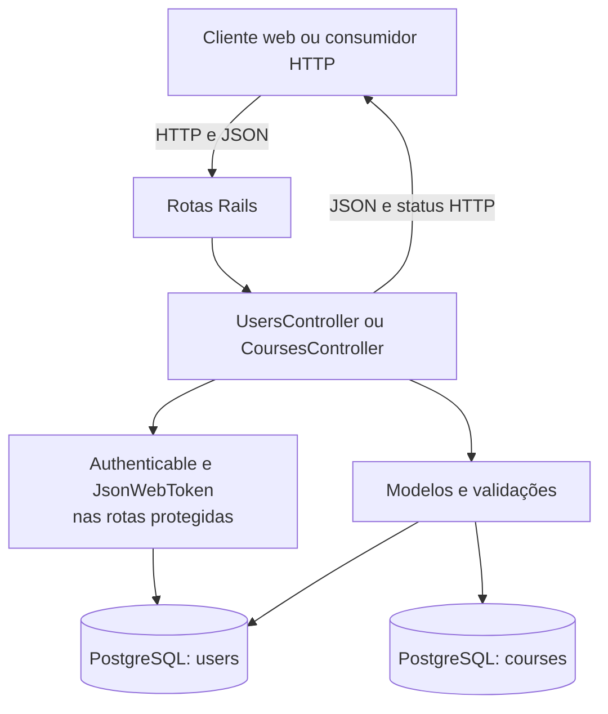

# Arquitetura

## Visão geral

Find Your Course é uma API REST construída com Ruby on Rails 7.2, configurada em modo `api_only`. Ela recebe e responde JSON, aplica regras de validação nos modelos e persiste usuários e cursos em PostgreSQL. O cliente web é mantido em um repositório separado.

## Componentes e fluxo de requisição



As rotas são declaradas em `config/routes.rb`. `ApplicationController` inclui o concern `Authenticable`. Os controladores tratam os parâmetros da requisição, chamam os modelos e serializam os resultados como JSON. As regras de validação ficam em `User` e `Course`; o acesso ao banco é feito pelo Active Record.

## Domínio e persistência

O banco possui duas tabelas principais:

| Entidade | Campos de domínio | Regras principais |
|---|---|---|
| `User` | `name`, `email`, `password_digest`, `favorite` | Nome obrigatório; email obrigatório, validado e único sem diferenciar maiúsculas; senha com pelo menos 6 caracteres. `has_secure_password` usa bcrypt. |
| `Course` | `name`, `owner`, `starts`, `value`, `description`, `image` | Campos obrigatórios; limites de tamanho para nome, responsável e imagem; `starts` deve ser inteiro e `value` numérico. |

O schema está em `db/schema.rb` e as alterações estruturais são registradas em `db/migrate/`. No schema atual, `courses.owner` é texto e não uma chave estrangeira para `users`; não há associação Active Record entre essas entidades.

## API e controladores

`UsersController` implementa cadastro, login e operações sobre a conta autenticada. `GET /users` devolve somente o usuário do token. A leitura por ID, atualização de favorito e exclusão são limitadas ao próprio usuário.

`CoursesController` implementa leitura e operações CRUD de cursos. As leituras são públicas; criar, atualizar ou excluir curso exige um JWT válido. Os parâmetros aceitos são filtrados com strong parameters.

As rotas disponíveis são:

| Método | Caminho | Acesso | Ação |
|---|---|---|---|
| `POST` | `/login` | Público | Autenticar e emitir JWT |
| `POST` | `/users` | Público | Criar usuário |
| `GET` | `/users`, `/users/:id` | JWT; próprio usuário | Consultar a conta autenticada |
| `PATCH` | `/users/:id` | JWT; próprio usuário | Atualizar favorito |
| `DELETE` | `/users/:id` | JWT; próprio usuário | Excluir a conta |
| `GET` | `/courses`, `/courses/:id` | Público | Consultar cursos |
| `POST` | `/courses` | JWT | Criar curso |
| `PATCH` | `/courses/:id` | JWT | Atualizar curso |
| `DELETE` | `/courses/:id` | JWT | Excluir curso |

Respostas de sucesso usam JSON e códigos HTTP adequados à operação (`200`, `201` ou `204`). Requisições sem autenticação válida recebem `401`; tentativas de acessar outro usuário recebem `403`; registros ausentes recebem `404`; erros de validação recebem `422`.

## Autenticação

`JsonWebToken` assina tokens com HS256 e validade padrão de 24 horas. O segredo vem de `Rails.application.credentials.secret_key_base` ou, como fallback, de `SECRET_KEY_BASE`. A decodificação exige assinatura válida, expiração e `user_id`. `Authenticable` extrai o bearer token do cabeçalho `Authorization`, localiza o usuário e interrompe a requisição quando a autenticação falha.

## Configuração e execução

- `config/database.yml` configura PostgreSQL. `DATABASE_URL` pode fornecer a conexão nos ambientes de teste ou em plataformas de hospedagem compatíveis.
- `config/initializers/cors.rb` permite origens listadas em `CORS_ORIGINS`; em desenvolvimento, o padrão é `http://localhost:3000`.
- `config/environments/production.rb` ativa HTTPS obrigatório, carregamento antecipado e exige a chave mestre do Rails.
- `db/seeds.rb` requer `SEED_USER_PASSWORD` e cria um usuário e cursos de exemplo.
- Puma é o servidor HTTP configurado em `config/puma.rb`.

## Estrutura do código

```text
app/
  controllers/       endpoints HTTP e autorização
  controllers/concerns/ autenticação compartilhada
  models/            entidades, validações e acesso ao banco
  services/           emissão e validação de JWT
  jobs/               base para tarefas em segundo plano
  mailers/            base para envio de email
config/               rotas, ambiente, banco e inicializadores
db/                   migrações, schema e seeds
spec/, test/          especificações e testes
```

Jobs, mailers e canais estão presentes como estruturas geradas pelo Rails; o fluxo principal da API não depende deles atualmente.
